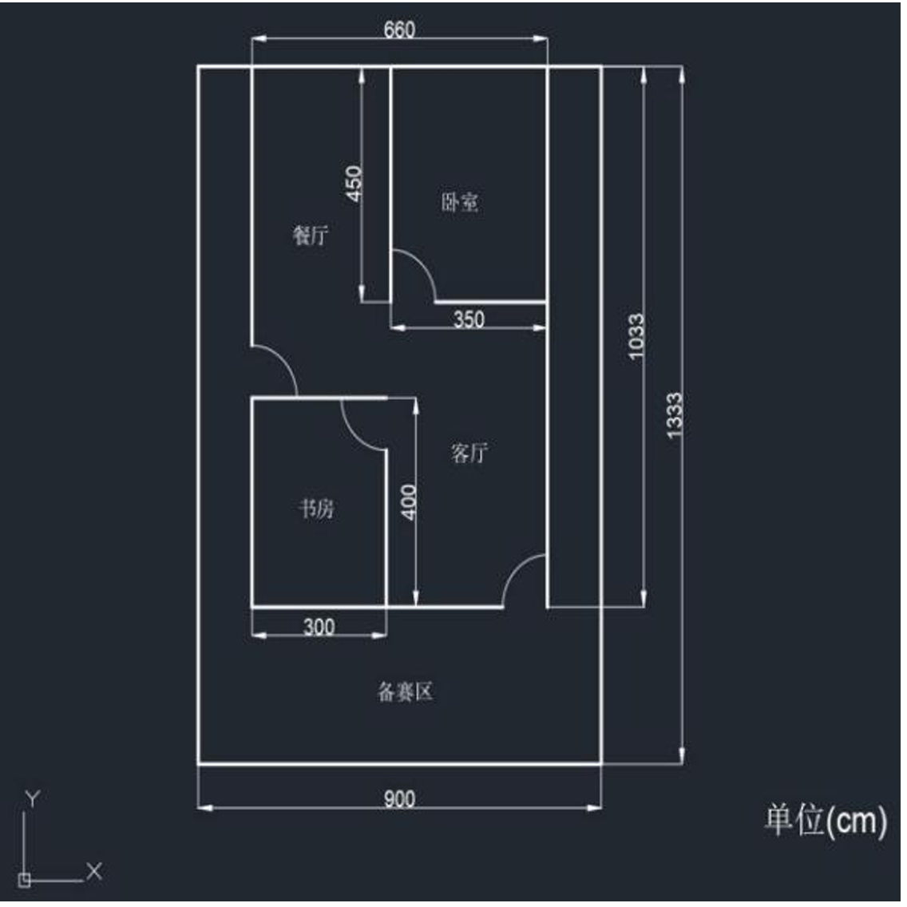
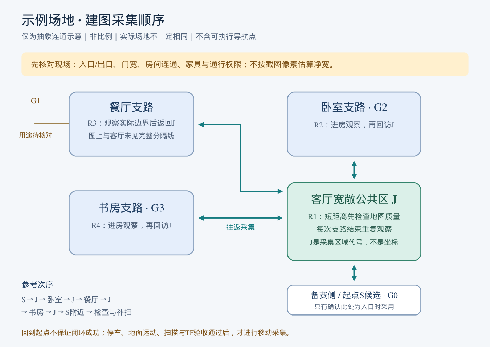

# 示例场地建图准备

准备日期：2026-11-18，状态更新：11月19日。已准备资料与只读检查工具；雷达静态发布与RViz显示已有单独实测，见[雷达验收](雷达静态验收.md)。**完整TF、地面采集与SLAM尚未执行，未生成实测地图；只读脚本尚未在车上运行。**

> 用户已说明：这张图与实际搭建场地“不一定一致”。本页用于练习如何勘场和采集；全部图纸信息须与实地核对。不能直接用来设定地图原点、房间多边形、导航目标或自动运动路线。

## 1. 队友到现场先做什么

1. 携带卷尺、电脑、USB数据线、充好电的小车及稳定支撑物；连接方法见 [USB SSH](USB直连与SSH登录.md)。
2. 先拍全景和各房间连接处，记录场地日期、布局版本、实际入口/出口与家具，不先假定图中开口身份。
3. 填写 [现场测量表](../场地资料/现场测量表.csv)。图纸标注和实际测量分列，未测项留空。
4. 停车保护及地面运动未验收前，先完成静态测量与静态传感器检查。运动前置条件见 [底盘验收](底盘启动与架空验收.md)。
5. 使用本页只读工具收集包、Topic和TF；回传输出后，再确定这台车的实际建图启动组合。

## 2. 从例图能够读取什么

原图：

下表只有“图纸标注”，没有任何现场实测尺寸：

| 图上项目 | 标注换算 | 使用边界 |
| --- | --- | --- |
| 外框宽、长 | 900 cm × 1333 cm，即9.00 m × 13.33 m | 外框含备赛区域，不能整体认作比赛活动区 |
| 内部主要区域宽、长 | 660 cm × 1033 cm，即6.60 m × 10.33 m | 按尺寸线理解的内部区域，约68.18㎡；不是实地面积，也不是房间可行驶面积之和 |
| 卧室横向尺寸 | 350 cm，即3.50 m | 墙厚及净宽定义未明确 |
| 卧室纵向尺寸线 | 450 cm，即4.50 m | 端点所对应的实际墙面待核对 |
| 书房横向尺寸 | 300 cm，即3.00 m | 现场核对墙面和净宽 |
| 书房纵向尺寸 | 400 cm，即4.00 m | 同上 |
| 下方备赛带纵向差值 | 13.33−10.33=3.00 m | 仅按两条共顶尺寸线计算，不推导左右外围带宽及通行权限 |
| 门洞宽度、家具、车体尺寸 | 图中无法确定 | 不能从截图像素或门扇圆弧当作精确测量 |

例图的X/Y方向只是图纸约定。SLAM地图的方向、原点与图像origin须根据实际建图结果处理，不能把本图左下角直接认作ROS的map原点。

暂定开口编号：**G0=客厅下方与备赛侧相连的开口；G1=餐厅左侧开口；G2=卧室开口；G3=书房开口。** 编号只便于沟通，入口/出口、净宽、通行权限和真实位置均待核对。图中餐厅与客厅之间未见完整分隔线，不能强加一堵墙。

## 3. 练习采集顺序：先建立公共区域，再进入支路



可缩放原图：[SVG版](assets/建图采集顺序_非比例.svg)。

图为抽象连通关系，不含坐标、距离或可执行轨迹。仅当现场关系确实相同、实际入口允许且各通道可通行时参考：

| 步骤 | 参考顺序 | 观察重点 |
| --- | --- | --- |
| R0 | 确认入口及起点S；若实际入口为G0，则从G0进入客厅宽敞区J | 避开门洞布置起点，拍摄可复认结构；静止扫描与TF应正常 |
| R1 | J附近短距离低速采集，再返回同一区域 | 先确认墙体不会随运动明显重影、方向错误或跳变，异常先停查，不继续全场 |
| R2 | J→G2→卧室→G2→J | 进入后在有净空处改变视角，覆盖可见墙角及家具；不要强求贴墙一圈 |
| R3 | J→餐厅→J | 确认餐厅实际边界；G1外部区域只有在允许且可通行时才作为可选采集支路 |
| R4 | J→G3→书房→G3→J | 门洞和家具遮挡；不在门内原地大幅转向 |
| R5 | J→起点S附近，重复观察相同结构 | 检查重访后的对齐和地图形变；回到起点不等于已证明闭环成功 |
| R6 | 人工检查缺失区域，必要时有限补扫并保存 | 门洞、墙体、房间连通、尺寸及重影；不把图纸画成理想地图掩盖错误 |

实际入口若是G1或布局不同，重新安排起点与支路顺序；所有R编号都是人工采集建议，不传给导航系统。速度与转向幅度依地面验收及停止能力确定，不照抄原方案上限；建图初期优先小幅转向和已验证的前进方式。

二维激光主要扫其安装平面。桌面上方、墙体背面等未观测区域不能靠“多走一圈”保证覆盖；前向相机视野也不等于整车四周都有障碍保护。

## 4. 启动建图之前的放行表

- [ ] 已确认电机物理停止方式及独立指令时效保护；地面正反方向与反馈单位通过，记录停止过程。
- [ ] 雷达实际型号、设备路径、安装高度和方向已核对；有新鲜LaserScan，已知墙距对比合理。
- [ ] 配置的odom坐标到base坐标存在唯一、连续的动态TF；base到雷达帧的外参符合实测。
- [ ] 当前只有一套底盘驱动和预期控制来源；建图时不同时运行AMCL或另一套SLAM发布同一map变换。
- [ ] 实机use_sim_time=false；各设备时间可配套；没有用最新TF或伪造时间掩盖错误。
- [ ] 已建立版本、日志和地图保存路径；操作员负责运动，另一人观察数据和周围空间（人员配置允许时）。

**已知现车差异：** 最小base_serial启动只验证过消息，不提供完整导航TF。复制配置的EKF使用odom_combined→base_footprint，滤波结果Topic重映射到/odom_combined；这里“Topic”和“frame”是不同概念。完整启动还包含模型与静态TF，尚未验收，不能与现有base_serial实例直接叠加。复制的雷达总入口选择N10P，但它还会查找其他雷达包路径，若报包缺失应先检查入口本身，不认定N10P硬件损坏。

## 5. 可以现在运行的只读准备工具

[mapping-preflight.sh](../tools/mapping-preflight.sh) 仅盘点，不安装、不改参数、不启动传感器/SLAM、不发布运动指令，不自动判定可以移动。它不替代上述物理检查。

Windows仓库根目录上传：

```powershell
scp "D:\Personal\Desktop\LETSROS\tools\mapping-preflight.sh" wheeltec@192.168.128.10:/tmp/mapping-preflight.sh
```

在已经正确加载ROS环境的小车SSH shell：

```bash
bash /tmp/mapping-preflight.sh
```

默认只列包、启动文件和ROS图，不等待传感器。已经按实际入口启动底盘/雷达、确认静态条件后，可加短时观察：

```bash
bash /tmp/mapping-preflight.sh --observe
```

观察模式候选值为/scan、odom_combined、base_footprint，只是基于已有配置；输出真实帧名后按实际情况覆盖，例如：

```bash
SCAN_TOPIC=/actual_scan ODOM_FRAME=actual_odom BASE_FRAME=actual_base LIDAR_FRAME=actual_laser bash /tmp/mapping-preflight.sh --observe
```

actual_*是说明占位，不原样运行。未指定LIDAR_FRAME时工具只打印LaserScan头部，不猜测雷达TF。超时、无包、空ROS图都只作为诊断结果，不自动启动程序补救；工具总返回码不表示验收通过。输出可能含设备与本地路径，分享前按团队规则检查。

## 6. 后续建图配置与保存：待实车盘点后确定

不提前猜测wheeltec_robot_slam包里的launch名称。先查工具输出中的已安装文件，再检查是否包含另一套SLAM、底盘或AMCL。若采用原方案的slam_toolbox，使用车上已安装Humble版本的完整参数文件作为基线，再核对：

| 参数/关系 | 准备原则 |
| --- | --- |
| mode / use_sim_time | mapping / false |
| map_frame | map，与其他模块统一且唯一发布 |
| odom_frame | 实际连续里程计TF的父帧；复制配置提示odom_combined，仍须实机检查 |
| base_frame | 实际base帧；目前消息为base_footprint |
| scan_topic | 实际LaserScan Topic，不能仅凭名称假定/scan可用 |
| resolution | 可先讨论0.05m作为起调值；不是实测精度，门洞表达不足时再评估 |
| 雷达范围、更新与运动阈值 | 根据N10P实际输出、采集速度、算力和安装版本确定，不直接照抄通用最大量程 |

已核对官方Humble的online_async_launch.py提供use_sim_time和slam_params_file入口；其默认模拟时间为true，因此实机必须明确覆盖。以下仅为**完成放行与参数检查后**的启动模板，当前不执行：

```bash
# 先将路径替换成已检查的完整参数文件；该命令不负责启动底盘、雷达或TF
ros2 launch slam_toolbox online_async_launch.py use_sim_time:=false slam_params_file:=/absolute/path/to/checked_mapping.yaml
```

保存前确认/map真实更新且质量通过，再使用安装版帮助核对参数：

```bash
ros2 run nav2_map_server map_saver_cli --help
```

不要只保存RViz截图：导航需要栅格图像与配套YAML；如需继续同一SLAM会话，还要按实际服务保存序列化pose graph，和普通栅格保存区别处理。使用唯一会话名，避免覆盖可用地图。把分辨率、origin、frame、布局版本和启动参数一起归档。地图目录、bag目录与原始个人数据不要未经检查直接上传Git。

官方核对入口：[slam_toolbox Humble参数](https://github.com/SteveMacenski/slam_toolbox/blob/humble/config/mapper_params_online_async.yaml)、[Humble启动文件](https://github.com/SteveMacenski/slam_toolbox/blob/humble/launch/online_async_launch.py)、[slam_toolbox输入与保存接口](https://github.com/SteveMacenski/slam_toolbox/blob/humble/README.md)、[Nav2 Map Server](https://github.com/ros-navigation/navigation2/blob/humble/nav2_map_server/README.md)。线上代码只作核对依据，最终以安装版为准。

## 7. 第一趟现场结束时交回什么

- 场地全景、入口/出口和每个房间连接处照片；说明与例图哪些地方不同。
- 填好的现场测量表，未测项明确留空；车体外形和雷达/相机安装实测记录。
- 只读工具输出、具体启动命令，以及每个观察位置的彩色/深度样例（若驱动已可用）。
- 若满足运动和SLAM前置条件：实际采集顺序、地图及元数据、缺陷截图和是否需要补扫；若未满足则明确“本次没有建图”。
- 更新[执行计划](../执行计划表.md)对应状态与当日日志。勘场完成不等于D5、D7或D8已通过。
